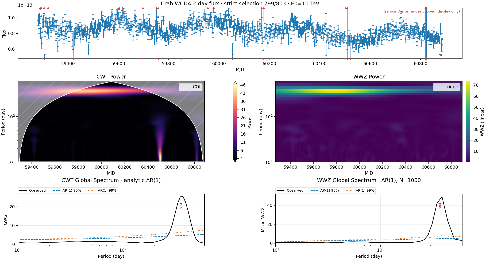
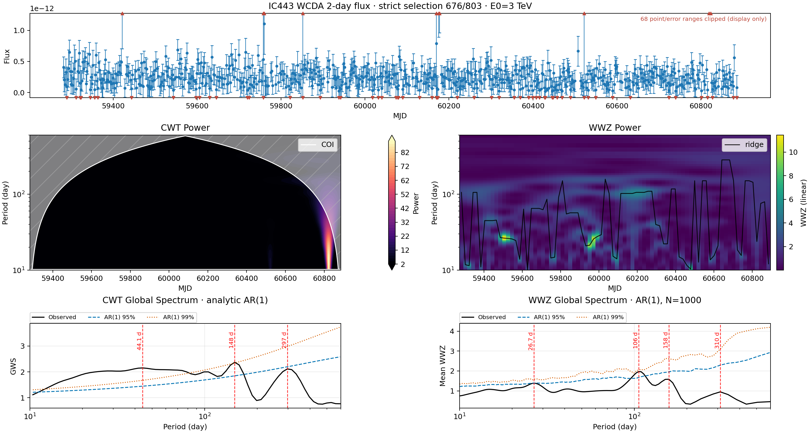
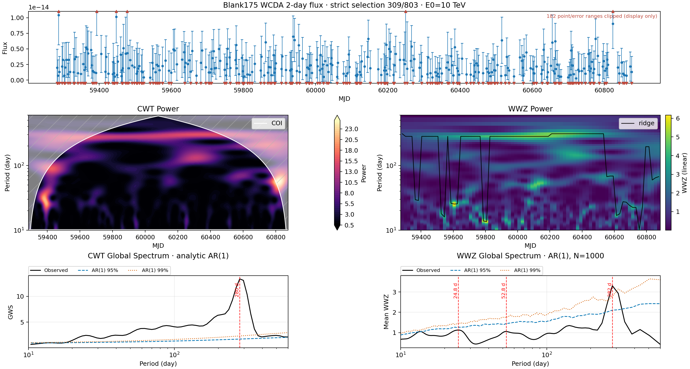
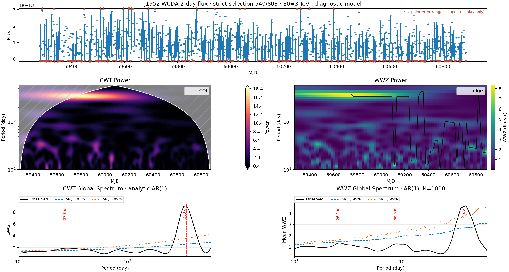

## 总体结论

在本次高斯 AR(1) 条件模型下，Crab 出现四源校正 FAP < 0.05 的 WWZ 候选。该统计阈值不等同于已确认天体周期；还需判断观测响应、筛选和拟合系统效应。

| 源 | 最低global FAP对应WWZ周期 / d | local FAP | global FAP | 四源校正FAP |
| --- | ---: | ---: | ---: | ---: |
| Crab | 384.35 | 0.000999 | 0.000999 | 0.003996 |
| IC443 | 105.71 | 0.02797 | 0.5105 | 1 |
| Blank175 | 281.60 | 0.008991 | 0.06094 | 0.2438 |
| J1952 | 384.35 | 0.002997 | 0.02498 | 0.0999 |

本报告覆盖 Crab、IC443、Blank175、J1952，每源 WWZ 使用 1000 次模拟；完整观测范围 MJD 59281.66666667–60885.66666667，搜索 10–600 天。四源属于探测器对照分析，强周期结构也可能反映响应或观测系统效应。

> [!WARNING]
> 结果是严格筛选样本下的周期诊断。Blank175 大量零边界箱被剔除，样本分布明显改变；J1952 的冻结模型仍有未解决的 ROI 残差，原 calibration gate 未通过。当前模拟不包含这两类生成机制。

## 数据筛选与实际采样

| 源 | 原始箱 | 保留箱 | CWT网格箱 | 插值箱 / 占网格 | 最大有效点间隔 / d | AR(1) α / 真实相邻对 | E0 / TeV |
| --- | ---: | ---: | ---: | ---: | ---: | --- | ---: |
| Crab | 803 | 799 | 803 | 4 / 0.5% | 4 | 0.3379 / 794 | 10 |
| IC443 | 803 | 676 | 803 | 127 / 15.8% | 8 | 0.0027 / 568 | 3 |
| Blank175 | 803 | 309 | 797 | 488 / 61.2% | 22 | -0.1129 / 110 | 10 |
| J1952 | 803 | 540 | 803 | 263 / 32.8% | 12 | 0.0624 / 349 | 3 |

保留条件为 valid_fit=True、有限时间与 flux、有限正误差及正曝光；排除明确的 at_boundary=True、error_reliable=False、low_exposure=True、extreme_flux=True。空标记表示未知，不据此剔除。不新增 TS 阈值、sigma clipping、去趋势或再拟合。逐箱排除原因保存在 selection_audit.csv；同一箱可同时触发多个原因。

CWT 在首末保留点之间恢复 2day 网格，内部缺口线性插值、不向两端外推；插值点不作为真实观测绘制，也没有虚构误差。WWZ 直接采用真实保留时刻。归一化能量不同，不能直接比较四源绝对 flux。

## 方法、显著性与读图

- **CWT：**复用 Morlet(6)，dj=1/12；flux 内部标准化。全局谱取时间平均，沿用 PyCWT 解析 AR(1) 95%/99% 参考。COI 阴影表示边缘效应显著区域；全局谱仍按现有代码包含所有时间格点，不把 COI 之外的贡献自动剔除。
- **WWZ：**复用现有 libwwz linear-grid 实现，时间分割 80、频率步长系数 0.5、decay constant=0.0125。全局谱为时域平均 WWZ。flux_err 只参与有效性检查和重复时刻合并，未作为逐点逆方差权重传入 WWZ。
- **AR(1)：**α 仅由真实观测中相隔2天的相邻点对估计，按两组配对值各自中心化求相关，并限制在 [-0.95,0.95]；不把跨缺口的点当成一步相邻。CWT 和 WWZ 使用相同 α。
- **模拟：**每源 1000 条高斯 AR(1) 序列，先在原始完整 2day 时间轴生成，再应用固定严格筛选掩码。均值和样本标准差取保留 flux；不额外注入测量误差，也不重新模拟质量筛选。随机种子按固定源顺序派生。
- **候选峰：**全局谱内部峰，prominence 至少为功率跨度的10%，最小峰距两个频率箱。搜索边界上的最大值不会被强行记作内部候选峰；标出的峰不是自动成立的显著周期。
- **周期数值：**表中周期是搜索网格上的峰位置，未估计周期误差；显示的小数位不代表同等测量精度。线性频率网格在长周期端较稀疏。
- **95%/99%线：**逐周期的参考分位数，不是扫描整个频段后的置信度。表中“超过参考”比较该候选周期本身的峰值和该周期参考，FAP 则使用下面的窗口统计量。
- **local FAP：**候选周期±10%窗口内观测最大值，与每条模拟在同一窗口的最大值比较。**global FAP：**同一观测统计量与模拟在整个搜索频段内的最大值比较。两者均为 (超越次数+1)/(模拟数+1)。
- **四源校正：**min(1,4×global FAP)。这是四条 WWZ 曲线的 Bonferroni 校正，没有把 CWT 当作另一套已完成全局 FAP 的检验。CWT 的 FAP 留空。
- **图的布局：**顶部真实 LC；中左 CWT 功率和 COI、中右 WWZ 功率和 ridge；底部为各自全局谱、参考线与红色候选周期标记。点击图片可查看原尺寸。
- **显示范围：**每源按保留 flux 的1%–99%分位数，并上下各加分位跨度10%设 LC 纵轴。红色三角表示点或误差范围越界，数量按涉及的观测箱计；裁剪仅影响展示，所有保留值均参与计算。

## 四源结果与合成图

### Crab

保留 799/803 个真实箱；CWT 补入 4 个内部缺测箱。最大有效点间隔 4 天，AR(1) α=0.3379。保留 flux 全范围 2e-19–2.359e-13 TeV⁻¹ cm⁻² s⁻¹；主图有 29 个观测的点或误差范围越界。

WWZ 最低 global FAP 对应内部候选约 **384.35 d**，local FAP=0.0010，global FAP=0.0010，四源校正后=0.0040。

CWT 内部候选周期为 374.00 d；这里只评估解析参考线超越，不给出 CWT 全局 FAP。

**读图：**两种方法均显示突出的年尺度功率带；CWT约374天、WWZ约384天，早中段较强，长周期边缘区域受COI影响。Crab是探测器对照源，该结构应优先作为年尺度观测响应排查线索，而非天体QPO确认。



| 方法 | 周期 / d | 周期数 | 峰值超过95% / 99%参考 | local FAP | global FAP | 四源校正FAP |
| --- | ---: | ---: | --- | ---: | ---: | ---: |
| CWT | 374 | 4.29 | 是 / 是 | — | — | — |
| WWZ | 384.3 | 4.17 | 是 / 是 | 0.000999 | 0.000999 | 0.003996 |

### IC443

保留 676/803 个真实箱；CWT 补入 127 个内部缺测箱。最大有效点间隔 8 天，AR(1) α=0.0027。保留 flux 全范围 1.91e-14–1.919e-11 TeV⁻¹ cm⁻² s⁻¹；主图有 68 个观测的点或误差范围越界。

WWZ 最低 global FAP 对应内部候选约 **105.71 d**，local FAP=0.0280，global FAP=0.5105，四源校正后=1.0000。

CWT 内部候选周期为 44.13, 148.42, 296.85 d；这里只评估解析参考线超越，不给出 CWT 全局 FAP。

**读图：**CWT尾端有局域短周期强功率，其中一部分靠近边缘影响区域；WWZ脊线频繁跳变，没有与Crab类似的持续强年尺度带。部分CWT候选超过解析参考，但WWZ全频段检验不支持显著候选，不能将两者混同。

**质量标记限定：**严格筛选只按已提供的标记及基础条件执行，未自动剔除所有数值离群点。完整 flux 范围如上；显示越界不代表这些点已从周期分析排除。



| 方法 | 周期 / d | 周期数 | 峰值超过95% / 99%参考 | local FAP | global FAP | 四源校正FAP |
| --- | ---: | ---: | --- | ---: | ---: | ---: |
| CWT | 44.13 | 36.4 | 是 / 是 | — | — | — |
| CWT | 148.4 | 10.8 | 是 / 是 | — | — | — |
| CWT | 296.8 | 5.4 | 否 / 否 | — | — | — |
| WWZ | 26.66 | 60.2 | 否 / 否 | 0.1009 | 0.9331 | 1 |
| WWZ | 105.7 | 15.2 | 是 / 否 | 0.02797 | 0.5105 | 1 |
| WWZ | 157.7 | 10.2 | 否 / 否 | 0.1918 | 0.7862 | 1 |
| WWZ | 310.1 | 5.17 | 否 / 否 | 0.5415 | 1 | 1 |

### Blank175

保留 309/803 个真实箱；CWT 补入 488 个内部缺测箱。最大有效点间隔 22 天，AR(1) α=-0.1129。保留 flux 全范围 2.938e-16–1.13e-14 TeV⁻¹ cm⁻² s⁻¹；主图有 182 个观测的点或误差范围越界。

WWZ 最低 global FAP 对应内部候选约 **281.60 d**，local FAP=0.0090，global FAP=0.0609，四源校正后=0.2438。

CWT 内部候选周期为 280.18 d；这里只评估解析参考线超越，不给出 CWT 全局 FAP。

**读图：**CWT与WWZ在约280天附近均有结构，但WWZ全频段及四源校正后未达到0.05阈值；高达61.2%的CWT网格由插值构成，这种表面一致性不是独立的稳健性证明。

**解释限制：**严格筛选后只保留约38%的原始箱；较密集的 CWT 插值及正值选择会改变分布与短周期结构。其高斯 AR(1) 结果是对当前条件模型的诊断，不能代表未筛选空场的完整零假设。



| 方法 | 周期 / d | 周期数 | 峰值超过95% / 99%参考 | local FAP | global FAP | 四源校正FAP |
| --- | ---: | ---: | --- | ---: | ---: | ---: |
| CWT | 280.2 | 5.68 | 是 / 是 | — | — | — |
| WWZ | 24.82 | 64.2 | 否 / 否 | 0.2587 | 0.988 | 1 |
| WWZ | 52.8 | 30.2 | 否 / 否 | 0.4386 | 0.996 | 1 |
| WWZ | 281.6 | 5.65 | 是 / 是 | 0.008991 | 0.06094 | 0.2438 |

### J1952

保留 540/803 个真实箱；CWT 补入 263 个内部缺测箱。最大有效点间隔 12 天，AR(1) α=0.0624。保留 flux 全范围 9.23e-15–4.29e-13 TeV⁻¹ cm⁻² s⁻¹；主图有 227 个观测的点或误差范围越界。

WWZ 最低 global FAP 对应内部候选约 **384.35 d**，local FAP=0.0030，global FAP=0.0250，四源校正后=0.0999。

CWT 内部候选周期为 27.80, 353.01 d；这里只评估解析参考线超越，不给出 CWT 全局 FAP。

**读图：**长周期功率主要在前半段增强，后半段WWZ脊线更多转向较短周期；CWT约353天、WWZ约384天。WWZ年尺度候选与Crab落在相同网格周期，值得检查共同观测响应；四源校正后未达到0.05阈值。

**模型限定：**原全区间模型冻结、每箱仅 F0 自由；7个相邻≥5σ ROI 残差像素尚未解决。原 calibration gate 为 failed，本次周期计算没有解除该模型状态。



| 方法 | 周期 / d | 周期数 | 峰值超过95% / 99%参考 | local FAP | global FAP | 四源校正FAP |
| --- | ---: | ---: | --- | ---: | ---: | ---: |
| CWT | 27.8 | 57.7 | 是 / 是 | — | — | — |
| CWT | 353 | 4.54 | 是 / 是 | — | — | — |
| WWZ | 26.22 | 61.2 | 否 / 否 | 0.2038 | 0.973 | 1 |
| WWZ | 88.26 | 18.2 | 否 / 否 | 0.4655 | 0.993 | 1 |
| WWZ | 384.3 | 4.17 | 是 / 是 | 0.002997 | 0.02498 | 0.0999 |

## 解释边界与后续验证

1. **插值影响：**CWT 的解析参考是插值序列上的近似参考，没有传播插值不确定性；10–600天搜索保留了短周期段，但尤其是 Blank175，短周期相对缺口尺度较小，解释必须谨慎。
2. **筛选与噪声模型：**剔除边界点使样本成为条件样本。固定掩码、高斯 AR(1) 不描述非负截断、异方差测量误差、质量筛选概率及真实仪器响应变化。
3. **现有 WWZ 实现：**本次沿用已安装 libwwz，包括其首个观测索引未进入累加及方差中间量跨频率保留的既有行为；缓存仅加速重复计算，没有在本任务中重定义估计量。正式科学结论宜再用独立 WWZ 实现核对。
4. **候选与证据：**local窗口由观测候选峰定位，逐周期99%线不能代替全频段FAP；四源校正也不能修复零假设不合适的问题。年尺度或其他共同结构需与响应周期、曝光及对照源一致性联合检查。
5. **有限模拟：**1000次模拟的FAP最小分辨率为1/1001≈0.000999；四源校正最小约0.003996。不能报告0概率，也不把未达到分辨能力的显著性外推。

## 可复现记录与产物

原始发布包及解压文件保持不变：data/raw/wcda/detector_controls_2day_four_sources_20261011/。标准化输入为 data/processed/wcda_2day/detector_controls_20261011/。ZIP SHA256 为 a8eb5aa92293dcc7feaa269e90ce0ae65f5fe655a19067b8a0bb65407554744f。

筛选记录和两种输入保存在 data/processed/aligned/detector_controls_20261011/；变换数组、逐周期参考、1000条模拟全局谱及种子、候选表、图和运行元数据保存在 data/processed/periodicity/detector_controls_20261011/。运行元数据记录软件版本、代码哈希、输入SHA256、耗时及完整网格等价检查误差。

| 源 | 随机种子 | WWZ时间×频率格点 | 观测/模拟核对最大绝对差 | 耗时 / s |
| --- | ---: | --- | --- | ---: |
| Crab | 20261012 | 80 × 317 | 2.84e-11 / 5.51e-12 | 30.4 |
| IC443 | 20261013 | 80 × 317 | 1.76e-13 / 3.73e-14 | 26.3 |
| Blank175 | 20261014 | 80 × 315 | 1.17e-13 / 9.14e-14 | 13.7 |
| J1952 | 20261015 | 80 × 317 | 3.02e-13 / 2.66e-13 | 22.4 |

Python：`/Users/luoji/miniconda3/envs/py310/bin/python`。本地逐源运行，最多2个工作进程，每进程数值库线程数为1。版本：numpy 1.26.4；pandas 2.3.3；matplotlib 3.9.2；scipy 1.15.3；pycwt 0.3.0a22；libwwz 1.3.4。

```bash
/Users/luoji/miniconda3/envs/py310/bin/python src/pipeline/detector_controls_2day_qpo.py
# 只利用保存数组重新出图和生成报告，不重复模拟
/Users/luoji/miniconda3/envs/py310/bin/python src/pipeline/detector_controls_2day_qpo.py --render-only
```

本报告的四张图片内嵌于HTML，可离线阅读；Markdown来源使用本地PNG相对路径。未发布外部网站，未提交Git。
